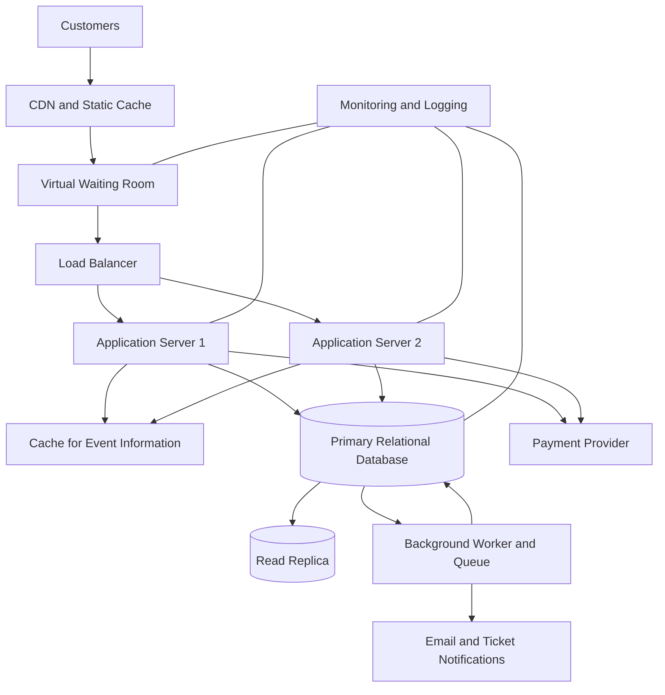

# TicketHub: Event Ticketing System Design

## 1. Requirements

TicketHub is a website where users can discover events, view available seats, purchase tickets, and access their confirmed bookings. The system must remain reliable during popular ticket releases, when demand can greatly exceed the number of available seats.

### Functional requirements

1. Users can register, log in, and view their accounts.
2. Users can browse events and view event details, prices, dates, and venues.
3. Users can view a seating plan and see which seats are available, held, or sold.
4. Users can temporarily hold available seats while completing checkout.
5. Users can pay for their orders and receive confirmation when payment succeeds.
6. Users can view their purchased tickets and order history.
7. The system releases expired seat holds so other users can purchase those seats.
8. The system provides clear messages when an event is sold out, a hold expires, or a payment fails.

### Non-functional requirements

- **Performance:** Event listings and seat availability should load quickly under normal traffic. The system should continue responding during major ticket releases.
- **Correctness:** A seat must never be sold to two customers. Orders must only be confirmed after successful payment verification.
- **Fairness:** Users should be processed through a fair queue during high-demand sales. The system should limit automated requests and prevent users from gaining an unfair advantage through excessive retries.
- **Availability:** The website should remain usable even if an application server fails.
- **Security:** User accounts and payment-related requests must be protected. Users must only access their own orders and tickets.
- **Scalability:** The system should support growth in users, events, and simultaneous requests by adding application servers and other resources.
- **Reliability:** Failed payments, expired holds, and temporary service errors must not leave seats permanently unavailable or create duplicate orders.
- **Maintainability:** The system should use clear APIs, a structured relational database, logging, and monitoring to make problems easier to investigate.

## 2. Traffic and Capacity Estimates

### Given information

- Registered users: 2,000,000
- Normal daily visitors: 50,000
- Pages viewed per visitor: 10
- Normal daily ticket sales: 5,000
- Popular concert seats: 20,000
- People attempting to buy tickets during the first 10 minutes: 200,000

These calculations are estimates. They assume traffic is spread evenly when calculating daily averages, while the popular-sale calculation uses the specified 10-minute window.

### Normal traffic

**Daily page views**

50,000 visitors × 10 pages = 500,000 page views per day.

**Average page views per second**

500,000 ÷ 86,400 seconds ≈ 5.8 page views per second.

**Average ticket sales per second**

5,000 ÷ 86,400 seconds ≈ 0.058 ticket sales per second.

This is approximately one ticket sale every 17 seconds on average.

### Popular concert sale

**People attempting to buy tickets per second**

200,000 ÷ 600 seconds ≈ 333 people per second.

**Seats available per second**

20,000 ÷ 600 seconds ≈ 33 seats per second, if all seats are sold evenly throughout the 10-minute period.

**Demand compared with supply**

200,000 people ÷ 20,000 seats = 10 people competing for each seat on average.

If every person wants one seat, only 10% of those attempting to buy can obtain a seat. The remaining customers need a clear sold-out or unavailable message.

### Comparison

| Metric                          |                      Normal day |                      Popular concert sale |
| ------------------------------- | ------------------------------: | ----------------------------------------: |
| Visitors or buyers              |                  50,000 per day |                     200,000 in 10 minutes |
| Page views or purchase attempts |      500,000 page views per day |             333 buyer attempts per second |
| Average page views per second   |                             5.8 |  Depends on pages and API calls per buyer |
| Ticket demand                   |             5,000 sales per day |           200,000 people for 20,000 seats |
| Main challenge                  | Consistent everyday performance | Sudden traffic spikes and seat contention |

The popular sale has about 10 times as many people attempting to buy tickets as there are seats. It also concentrates requests into a very short period.

For an additional planning estimate, assume each of the 200,000 buyers generates five API requests during the sale. That gives:

200,000 × 5 ÷ 600 ≈ 1,667 API requests per second.

This is a planning assumption, not a measured request rate. Actual traffic depends on the website design, retries, polling, and the number of requests each customer makes.

TicketHub should therefore use caching for public event information, a controlled queue for the sale, scalable application servers, and database protection for seat reservations.

## 3. API Design

The API allows the website to communicate with the application server. It uses REST-style endpoints and JSON request and response bodies.

| Method and endpoint                  | Purpose                               | Expected response                         |
| ------------------------------------ | ------------------------------------- | ----------------------------------------- |
| `GET /api/events`                    | Browse upcoming events                | `200 OK` with an event list               |
| `GET /api/events/{eventId}`          | View event details                    | `200 OK` or `404 Not Found`               |
| `GET /api/events/{eventId}/seats`    | View seat availability                | `200 OK` with seat statuses               |
| `POST /api/seat-holds`               | Temporarily hold available seats      | `201 Created` or `409 Conflict`           |
| `DELETE /api/seat-holds/{holdId}`    | Release a hold before expiry          | `204 No Content` or an appropriate error  |
| `POST /api/orders`                   | Create an order from valid held seats | `201 Created` or `409 Conflict`           |
| `POST /api/orders/{orderId}/payment` | Start payment for an order            | `202 Accepted` while payment is processed |
| `GET /api/orders/{orderId}`          | View an order's status                | `200 OK` or `404 Not Found`               |
| `GET /api/me/tickets`                | View the signed-in user's tickets     | `200 OK` with the user's tickets          |

### Example: holding seats

Request:

`POST /api/seat-holds`

```json
{
  "eventId": 42,
  "seatIds": [101, 102]
}
```

A successful response could be:

```json
{
  "holdId": "hold-abc123",
  "eventId": 42,
  "seatIds": [101, 102],
  "status": "HELD",
  "expiresAt": "2026-10-30T12:05:00Z"
}
```

The example expiry is illustrative. In production, the server generates the actual expiry time.

If either requested seat is no longer available, the server returns `409 Conflict` and does not create a partial hold. This gives the customer a clear opportunity to choose different seats.

### Example: creating an order

Request:

`POST /api/orders`

```json
{
  "holdId": "hold-abc123",
  "idempotencyKey": "checkout-unique-001"
}
```

The server verifies that the hold belongs to the signed-in user, has not expired, and contains seats that can still be purchased.

### Important API rules

- `200 OK`: A request succeeded.
- `201 Created`: A resource such as a hold or order was created.
- `202 Accepted`: Payment processing has started but may not be complete.
- `400 Bad Request`: The request contains invalid data.
- `401 Unauthorized`: The user is not authenticated.
- `403 Forbidden`: The user does not have permission to access the resource.
- `404 Not Found`: The requested resource does not exist or is not accessible.
- `409 Conflict`: A seat is unavailable or the requested action conflicts with its current state.
- `429 Too Many Requests`: A client has exceeded the allowed request rate.
- `500 Internal Server Error`: An unexpected server failure occurred.

Payment requests should use an idempotency key. If a customer retries because of a timeout, the server should return the existing result instead of creating another payment or order.

## 4. Data Model

TicketHub uses a relational database such as PostgreSQL. A relational database is suitable because orders, payments, users, and seats have relationships that must remain consistent.

### Table 1: users

Stores customer account information.

| Column          | Type                 | Purpose                  |
| --------------- | -------------------- | ------------------------ |
| `user_id`       | BIGINT, primary key  | Unique user identifier   |
| `name`          | VARCHAR(100)         | Customer name            |
| `email`         | VARCHAR(255), unique | Login and contact email  |
| `password_hash` | VARCHAR(255)         | Securely hashed password |
| `created_at`    | TIMESTAMP            | Account creation time    |

Passwords must never be stored as plain text.

### Table 2: events

Stores concerts and other events.

| Column       | Type                | Purpose                                     |
| ------------ | ------------------- | ------------------------------------------- |
| `event_id`   | BIGINT, primary key | Unique event identifier                     |
| `event_name` | VARCHAR(200)        | Event name                                  |
| `venue`      | VARCHAR(200)        | Event location                              |
| `event_date` | TIMESTAMP           | Event start date and time                   |
| `status`     | VARCHAR(20)         | Event state, such as scheduled or cancelled |

### Table 3: seats

Stores the individual seats available for each event.

| Column       | Type                | Purpose                         |
| ------------ | ------------------- | ------------------------------- |
| `seat_id`    | BIGINT, primary key | Unique seat record              |
| `event_id`   | BIGINT, foreign key | Event to which the seat belongs |
| `seat_label` | VARCHAR(30)         | Label such as A12               |
| `price`      | DECIMAL(10,2)       | Ticket price                    |
| `status`     | VARCHAR(20)         | AVAILABLE, HELD, or SOLD        |

A unique constraint on `(event_id, seat_label)` prevents duplicate seat labels for the same event.

### Table 4: orders

Stores a customer's checkout and purchase status.

| Column            | Type                 | Purpose                                                |
| ----------------- | -------------------- | ------------------------------------------------------ |
| `order_id`        | BIGINT, primary key  | Unique order identifier                                |
| `user_id`         | BIGINT, foreign key  | Customer placing the order                             |
| `status`          | VARCHAR(20)          | PENDING, PAID, FAILED, or EXPIRED                      |
| `total_amount`    | DECIMAL(10,2)        | Total order value                                      |
| `idempotency_key` | VARCHAR(100), unique | Prevents duplicate order creation for the same request |
| `created_at`      | TIMESTAMP            | Order creation time                                    |

### Table 5: seat_holds

Records temporary reservations before payment.

| Column       | Type                | Purpose                           |
| ------------ | ------------------- | --------------------------------- |
| `hold_id`    | BIGINT, primary key | Unique hold identifier            |
| `user_id`    | BIGINT, foreign key | Customer holding the seats        |
| `seat_id`    | BIGINT, foreign key | Seat being held                   |
| `expires_at` | TIMESTAMP           | Time after which the hold expires |
| `status`     | VARCHAR(20)         | ACTIVE, CONVERTED, or RELEASED    |

Each hold row refers to one seat. A database transaction must ensure that a seat cannot have two active holds at the same time. Expired holds must be treated as unavailable until the system safely releases or replaces them.

### Table 6: order_items

Connects orders to the seats being purchased.

| Column              | Type                | Purpose                    |
| ------------------- | ------------------- | -------------------------- |
| `order_item_id`     | BIGINT, primary key | Unique order item          |
| `order_id`          | BIGINT, foreign key | Parent order               |
| `seat_id`           | BIGINT, foreign key | Seat purchased             |
| `price_at_purchase` | DECIMAL(10,2)       | Price recorded at checkout |

A unique constraint on `seat_id` prevents the same seat from appearing in two order items. This assumes each seat record represents one event-specific seat and that a sold seat cannot be resold.

### Relationships

- One user can create many orders.
- One event has many seats.
- One user can create many seat holds.
- One seat can have many historical hold records, but only one active hold at a time.
- One order can contain multiple order items.
- Each order item refers to one seat.
- A seat can appear in only one successful purchase.

The foreign keys enforce valid relationships, while unique constraints protect important business rules.

## 5. Preventing Double-Booking

Preventing two customers from buying the same seat is the most important correctness requirement.

A simple availability check is not enough. For example, two customers might check seat A12 at nearly the same time. Both requests could see `AVAILABLE` before either request updates the database. Without transaction protection, both could proceed to checkout.

TicketHub prevents this through **database transactions, row-level locking, constraints, and controlled seat states**.

### Seat states

- `AVAILABLE`: The seat can be held.
- `HELD`: A customer has temporary control of the seat while checking out.
- `SOLD`: Payment has been verified and the purchase is confirmed.

### How seat holding works

1. The customer requests a hold on one or more seats.
2. The server starts a database transaction.
3. The database locks the requested seat rows using row-level locking, such as `SELECT ... FOR UPDATE`.
4. The server checks the current status of each seat and whether any existing hold has expired.
5. If all seats are available, the server marks them as held and records the hold expiry time.
6. The transaction commits. If any seat cannot be held, the transaction rolls back and no partial reservation is created.
7. Another customer's request must wait for the locked rows and then recheck their status. It cannot successfully hold the same seats.

### How purchase confirmation works

When the customer pays, the server verifies the payment result with the payment provider. It then uses a database transaction to verify the hold, mark the order as paid, mark the seats as sold, and record the order items.

A unique database constraint on `order_items.seat_id` provides a final safeguard against selling the same seat twice. The database, rather than the browser, is the authority on whether a seat has been sold.

Payment processing should not hold a database transaction open while waiting for a slow external payment provider. Instead, the system uses the hold expiry, payment status, idempotency keys, and a controlled confirmation process to handle delays and retries safely.

### Handling expired holds and failed payments

A background worker checks for expired holds and releases seats that have not been purchased. A failed or cancelled payment must not result in a confirmed ticket. If a payment result arrives late, the server must check whether the hold and order are still valid before confirming the purchase. If the seat has already been released and sold to another customer, the system must not confirm a duplicate ticket; it should follow a refund or payment-reconciliation process.

This approach combines fast seat selection with strong database-level correctness.

## 6. System Architecture



### Component explanations

**Customers and CDN:** Customers use the website to browse events and buy tickets. A content delivery network (CDN) serves static files such as images, CSS, and JavaScript from locations closer to users, reducing load on the application servers.

**Virtual waiting room:** During a popular sale, customers enter a controlled queue. The system releases them at a rate the backend can handle. Queue tokens help preserve fair access, while rate limits and bot detection reduce abuse. Queue position should be assigned according to a clearly published sale policy.

**Load balancer:** Distributes requests across multiple application servers and stops sending new requests to unhealthy servers.

**Application servers:** Run the business logic for event browsing, seat holds, orders, authentication, and payment processing. Multiple servers allow the system to handle more requests and continue operating if one server fails.

**Cache:** Stores frequently requested public event information. Seat availability and purchase decisions must still be checked against authoritative database state; a cached value must never be the final authority for selling a seat.

**Primary relational database:** Stores users, events, seats, holds, orders, and order items. Transactions, row locks, foreign keys, and unique constraints protect the integrity of purchases.

**Read replica:** Handles suitable read-only queries, such as event details and some reports, reducing pressure on the primary database. Current seat availability and checkout decisions should use the primary database or another strongly consistent source.

**Payment provider:** Processes payments through a secure integration. TicketHub verifies payment outcomes and handles retries and delayed responses without creating duplicate purchases.

**Background worker and queue:** Processes tasks such as releasing expired holds, sending confirmations, reconciling payment results, and retrying notifications. This keeps slower tasks out of the main customer request.

**Monitoring and logging:** Tracks response times, queue length, database load, payment failures, application errors, and seat-hold conflicts. Alerts help the team respond before a problem becomes a major outage.

### How the architecture survives a big sale

1. The CDN serves static content without sending every request to the application servers.
2. The waiting room controls the number of customers entering the purchase flow at once.
3. The load balancer distributes requests across healthy application servers.
4. The cache reduces repeated reads for public event information.
5. The primary database serialises conflicting seat updates using transactions and row locks.
6. Rate limiting, request timeouts, and bounded retries prevent overloaded services from being overwhelmed by repeated requests.
7. Background workers process notifications and cleanup tasks separately from checkout.
8. Monitoring helps operators identify rising database load, payment errors, and queue delays.

The system should be load-tested before the sale, with special attention to the database and seat-hold endpoints. Adding application servers alone will not solve a database bottleneck.

## 7. Trade-offs

### Trade-off 1: Fairness versus speed

A waiting room makes access more controlled and reduces the risk of overwhelming the website. However, customers may have to wait before reaching the checkout page, which makes the experience feel slower.

**Decision:** Use a waiting room during high-demand releases, communicate queue status clearly, and release users at a rate supported by tested backend capacity.

### Trade-off 2: Strong consistency versus read performance

Checking every seat against the primary database adds load and can make seat browsing slower. Using cached or replicated data improves read performance but may show outdated availability.

**Decision:** Cache event descriptions and other public information, but verify seat holds and purchases against the authoritative database. Correctness takes priority over a slightly faster but inaccurate checkout.

### Trade-off 3: Longer holds versus customer convenience

Longer holds give customers more time to complete payment, but they keep seats unavailable to others. Short holds improve availability but may expire while a legitimate customer is paying.

**Decision:** Use a clearly communicated hold period, show a countdown, release expired holds safely, and design payment handling for delayed responses.

### Trade-off 4: Immediate processing versus background processing

Sending confirmation emails inside the checkout request is simple, but a slow email service could delay the purchase response. Moving notifications to a background queue makes checkout more responsive, but notifications may arrive later.

**Decision:** Confirm the purchase only after the order and seat state are safely committed, then send notifications asynchronously. The ticket remains accessible through the user's account even if an email is delayed.

## Conclusion

TicketHub needs more than a website that lists events and accepts payments. It must manage sudden traffic spikes, provide fair access, and protect the correctness of every sale.

The design combines a waiting room, scalable application servers, caching, background workers, and a relational database. Most importantly, seat holds use transactions and row-level locks, while database constraints prevent a seat from being confirmed in multiple orders. This makes the database the final authority on seat ownership and allows TicketHub to prioritise both customer experience and purchase correctness.
